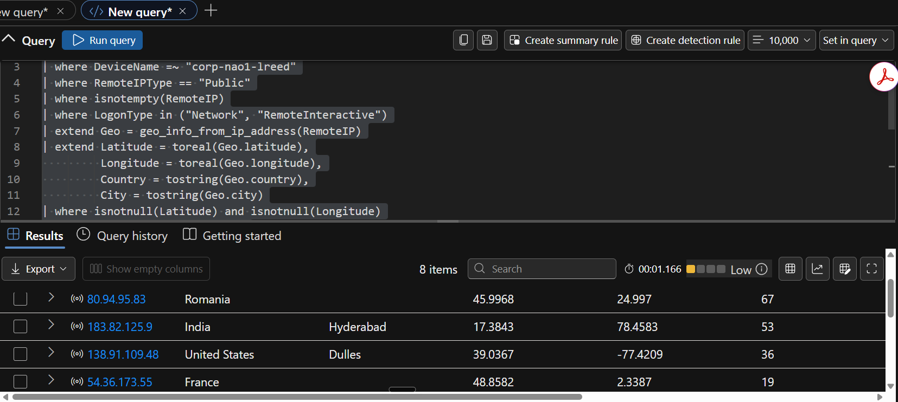

Incident Report

Incident Report — MySQL Ransom / Data-Destruction on corp-nao1-lreed

**Report ID:** IR-2026-1009-01 **Analyst:** Harold L.R. Watkins **Date written:** Oct 11, 2026 **Status:** Final

> **Time-zone note:** Timeline times are **EDT (UTC−4)**, matching how Defender Advanced Hunting renders TimeGenerated in this tenant. MySQL RawData carries its own **UTC** timestamp (4 h ahead, e.g. RawData 04:01Z ↔ 12:01 AM EDT). The VM clock is set to Pacific. KQL windows below are written in UTC.
>
> **Scope note:** Every finding was checked against the exported Advanced Hunting / Log Analytics results (New query (6), (17)–(25).csv, 1New query.csv) and the two MDE investigation packages. Each hunt is followed by the rows it returned in those exports. The general log records statements **submitted**, not whether each one succeeded.

1\. Executive Summary

At 12:01 AM EDT on Oct 9, 2026, an external actor at 64.89.163.94 logged in to the internet-exposed MySQL server on **corp-nao1-lreed** as root. In under two minutes the actor sampled the sakila and world databases (10 rows per table), dropped both, planted a RECOVER_YOUR_DATA ransom note demanding **0.0103 BTC**, wiped the binary logs and shut the server down. The note claims the data was "backed up," but the audit log shows only 10-row samples being read. The same day, eight public IPs made 200 Windows logon attempts against the host. Five of them succeeded against the decoy local account administrator (9 successes, 191 failures). No process, persistence or file activity attributable to those sessions appears in the exports.

**KQL to populate:**

> MySQLAudit_CL
>
> \| where \_ResourceId has "corp-nao1-lreed" // host scope (shared workspace)
>
> \| where TimeGenerated between (datetime(2026-10-08T22:00:00Z) .. datetime(2026-10-11T01:00:00Z))
>
> \| extend EventTime = todatetime(extract(@"^(\S+)", 1, RawData)),
>
> ThreadId = toint(extract(@"^\S+\s+(\d+)", 1, RawData)),
>
> Command = extract(@"^\S+\s+\d+\s+(\w+)", 1, RawData),
>
> Argument = trim(@"\s+", extract(@"^\S+\s+\d+\s+\w+\s\*(.\*)\$", 1, RawData)),
>
> SrcIP = extract(@"@'?(\d{1,3}(?:\\\d{1,3}){3})", 1, RawData)
>
> \| where Command == "Query"
>
> \| where Argument matches regex @"(?i)^(DROP\|RESET MASTER\|PURGE\|REVOKE\|SHUTDOWN)\b" or Argument has "RECOVER_YOUR_DATA"
>
> \| project EventTime, ThreadId, Argument
>
> \| order by EventTime asc

**Returned rows** *— excerpt from exported results (MySQLAudit_CL, New query (24).csv); times UTC*

| **Time** | **Thread** | **Statement**                                                                                     |
|----------|------------|---------------------------------------------------------------------------------------------------|
| 04:02:37 | 27         | DROP TABLE staff_list                                                                             |
| 04:02:37 | 27         | DROP TABLE store                                                                                  |
| 04:02:38 | 27         | CREATE TABLE IF NOT EXISTS RECOVER_YOUR_DATA (text VARCHAR(255))                                  |
| 04:02:38 | 27         | INSERT INTO RECOVER_YOUR_DATA (text) VALUES (' (for more information visit hxxps://cuq\[.\]in/84… |
| 04:02:38 | 27         | INSERT INTO RECOVER_YOUR_DATA (text) VALUES ('All your data was backed up by us. You must pay …   |
| 04:02:49 | 75         | DROP TABLE city                                                                                   |
| 04:02:49 | 75         | DROP TABLE country                                                                                |
| 04:02:49 | 75         | DROP TABLE countrylanguage                                                                        |
| 04:02:50 | 75         | CREATE TABLE IF NOT EXISTS RECOVER_YOUR_DATA (text VARCHAR(255))                                  |
| 04:02:50 | 75         | INSERT INTO RECOVER_YOUR_DATA (text) VALUES (' (for more information visit hxxps://cuq\[.\]in/84… |
| 04:02:50 | 75         | INSERT INTO RECOVER_YOUR_DATA (text) VALUES ('All your data was backed up by us. You must pay …   |
| 04:02:51 | 82         | DROP DATABASE sakila                                                                              |
| 04:02:52 | 82         | DROP DATABASE world                                                                               |
| 04:02:52 | 83         | CREATE DATABASE IF NOT EXISTS RECOVER_YOUR_DATA                                                   |
| 04:02:53 | 83         | CREATE TABLE IF NOT EXISTS RECOVER_YOUR_DATA (text VARCHAR(255))                                  |
| 04:02:53 | 83         | INSERT INTO RECOVER_YOUR_DATA (text) VALUES (' (for more information visit hxxps://cuq\[.\]in/84… |
| 04:02:53 | 83         | INSERT INTO RECOVER_YOUR_DATA (text) VALUES ('All your data was backed up by us. You must pay …   |
| 04:02:53 | 83         | USE RECOVER_YOUR_DATA                                                                             |
| 04:02:54 | 84         | RESET MASTER                                                                                      |
| 04:02:54 | 85         | PURGE BINARY LOGS TO 'CORP-NAO1-LREED-bin.000001'                                                 |
| 04:02:55 | 86         | REVOKE INSERT, UPDATE, DELETE, DROP, CREATE ON \*.\* FROM root@'%'                                |
| 04:02:56 | 87         | SHUTDOWN                                                                                          |

69 matching statements in the full export window; the 22 above are the 12:01–12:03 AM EDT attack burst. Later matches are follow-on RECOVER_YOUR_DATA probes and the operator's Oct 10 cleanup.

2\. Incident Details

| **Field**                   | **Value**                                                                                                                                                                                                                                              |
|-----------------------------|--------------------------------------------------------------------------------------------------------------------------------------------------------------------------------------------------------------------------------------------------------|
| Detection date/time         | Automated: **Oct 9, 10:56:49 AM** — Defender BruteForceActivityDetected (LogonBreach) on administrator from 54.36.173.55. Human: **Oct 9, 3:24:19 PM** — first local SELECT \* FROM recover_your_data by the operator. No MySQL-specific alert exists. |
| Earliest malicious activity | **Oct 9, 12:01:16 AM** — first successful remote root session from 64.89.163.94                                                                                                                                                                        |
| Reporter / detection source | **Not determined from available logs** (logs show the operator account lrtechpro reviewing the note via RDP from 10.0.8.4)                                                                                                                             |
| Classification — type       | Database extortion: data destruction + ransom note (MySQL "ransomware"/wiper). No file encryption. Secondary: brute-force of a decoy local Windows account.                                                                                            |
| Classification — severity   | **High** (privileged remote access, irreversible deletion, log destruction). All data was synthetic honeypot data, so real business impact is nil.                                                                                                     |
| Affected host               | corp-nao1-lreed — MDE device ID 6a3eb19c12c6067d21f7b41533ad622fde791db8, private IP 10.2.0.30, MySQL Server 8.0 on 3306/33060                                                                                                                         |
| Affected accounts           | MySQL root@%; Windows local administrator (SID …-1000, local admin, created by the operator as a decoy)                                                                                                                                                |
| Affected data stores        | MySQL sakila and world dropped. lnp_corp ("crown jewels") did not yet exist; it was created Oct 10.                                                                                                                                                    |

**KQL to populate:**

> // Affected host & account context; first automated detection
>
> DeviceLogonEvents
>
> \| where Timestamp between (datetime(2026-10-08T22:00:00Z) .. datetime(2026-10-11T01:00:00Z))
>
> \| where DeviceName =~ "corp-nao1-lreed"
>
> \| where ActionType in ("LogonSuccess","LogonFailed") and isnotempty(RemoteIP)
>
> \| project Timestamp, RemoteIP, AccountName, ActionType, LogonType
>
> \| order by Timestamp asc

*Figure 1 — Advanced Hunting: corp-nao1-lreed public-IP logons, 8 source rows (Defender portal).*

**Returned rows** *— excerpt from exported results (DeviceLogonEvents, New query (17).csv — administrator LogonSuccess rows); times UTC*

| **Time**       | **Account**   | **LogonType**     | **RemoteIP**   |
|----------------|---------------|-------------------|----------------|
| 10-09 04:17:44 | administrator | Network           | 183.82.125.9   |
| 10-09 07:37:03 | administrator | Network           | 114.12.35.157  |
| 10-09 07:37:40 | administrator | Network           | 114.12.35.157  |
| 10-09 07:39:33 | administrator | Network           | 114.12.35.157  |
| 10-09 13:45:51 | administrator | Network           | 212.237.124.81 |
| 10-09 13:46:15 | administrator | Network           | 212.237.124.81 |
| 10-09 13:47:32 | administrator | Network           | 212.237.124.81 |
| 10-09 14:56:47 | administrator | Network           | 54.36.173.55   |
| 10-09 17:59:18 | administrator | Network           | 80.94.95.83    |
| 10-09 17:59:20 | administrator | RemoteInteractive | 0.0.0.0        |
| 10-09 17:59:20 | administrator | RemoteInteractive | 0.0.0.0        |

3\. Impact Assessment

- **Confidentiality:** Limited, not ruled out. The actor ran mysqldump-style SELECT /\*!40001 SQL_NO_CACHE \*/ … LIMIT 10 19 times across 17 tables in sakila and world — at most ~190 rows. No full-table reads appear. NTANetAnalytics shows ~472 KB sent from the VM to 64.89.163.94 on 3306 in two aggregated flows; bulk exfiltration is not supported, but flow coverage is partial.

- **Integrity:** Breached. Foreign-key drops, DROP TABLE in both schemas, then DROP DATABASE sakila and world. RESET MASTER and PURGE BINARY LOGS removed the binary logs, blocking point-in-time recovery. REVOKE INSERT, UPDATE, DELETE, DROP, CREATE was run on root@%.

- **Availability:** SHUTDOWN at 12:02:56 AM. MySQL was accepting connections again by 4:46 AM (next inbound 3306 accept) — an outage of about 4 h at most. Who restarted it: **Not determined from available logs**.

- **Scope:** One VM. No file encryption, no suspicious outbound C2, and no process or file activity attributed to administrator in the exports. What the five administrator sessions did: **Not determined from available logs**.

- **Business impact:** None in practice (synthetic data). In production this would be a reportable data-destruction event with an unverified exfiltration claim.

**KQL to populate:**

> MySQLAudit_CL
>
> \| where \_ResourceId has "corp-nao1-lreed" // host scope (shared workspace)
>
> \| where TimeGenerated between (datetime(2026-10-08T22:00:00Z) .. datetime(2026-10-11T01:00:00Z))
>
> \| extend EventTime = todatetime(extract(@"^(\S+)", 1, RawData)),
>
> ThreadId = toint(extract(@"^\S+\s+(\d+)", 1, RawData)),
>
> Command = extract(@"^\S+\s+\d+\s+(\w+)", 1, RawData),
>
> Argument = trim(@"\s+", extract(@"^\S+\s+\d+\s+\w+\s\*(.\*)\$", 1, RawData)),
>
> SrcIP = extract(@"@'?(\d{1,3}(?:\\\d{1,3}){3})", 1, RawData)
>
> \| where Command == "Query"
>
> \| where EventTime between (datetime(2026-10-09T04:01:00Z) .. datetime(2026-10-09T04:03:00Z))
>
> \| extend Kind = case(Argument matches regex @"(?i)FROM \x60\w+\x60 WHERE 1 LIMIT", "DataRead",
>
> Argument matches regex @"(?i)^(DROP\|ALTER TABLE .\* DROP)", "Destroy", "Other")
>
> \| summarize Count = count(), Sample = take_any(Argument) by Kind

**Returned rows** *— excerpt from exported results (MySQLAudit_CL, 04:01–04:03 UTC); times UTC*

| **Kind** | **Count** | **Sample**                                                                         |
|----------|-----------|------------------------------------------------------------------------------------|
| Other    | 416       | SET AUTOCOMMIT=0                                                                   |
| Destroy  | 31        | ALTER TABLE staff DROP FOREIGN KEY fk_staff_address                                |
| DataRead | 19        | SELECT /\*!40001 SQL_NO_CACHE \*/ actor_id, first_name, last_name, last_update FR… |

DataRead = 19 LIMIT 10 sampling queries across 17 distinct tables (city and country read twice). "Other" is session setup and catalog lookups.

**KQL to populate:**

> // Exfil check: bytes VM -\> attacker (aggregated flows; absence is not proof)
>
> NTANetAnalytics
>
> \| where TimeGenerated between (datetime(2026-10-08T22:00:00Z) .. datetime(2026-10-11T01:00:00Z))
>
> \| where SrcIp in ("64.89.163.94","45.128.199.171","77.90.185.30") or DestIp in ("64.89.163.94","45.128.199.171","77.90.185.30")
>
> \| summarize Flows = count(), BytesToAttacker = sum(BytesDestToSrc), BytesFromAttacker = sum(BytesSrcToDest) by SrcIp, DestPort, FlowStatus

**Returned rows** *— excerpt from exported results (NTANetAnalytics, New query (25).csv); times UTC*

| **Attacker IP** | **Port** | **FlowStatus** | **Flows** | **Bytes VM→attacker** | **Bytes attacker→VM** |
|-----------------|----------|----------------|-----------|-----------------------|-----------------------|
| 64.89.163.94    | 3306     | Allowed        | 2         | 472,200               | 299,922               |
| 77.90.185.21    | 3306     | Denied         | 1         | 0                     | 0                     |

4\. Indicators of Compromise

| **Type**                                       | **Indicator**                                                                                         | **Source**                                                 |
|------------------------------------------------|-------------------------------------------------------------------------------------------------------|------------------------------------------------------------|
| BTC address                                    | bc1qt6kstjjdatqnxd3ksdcfv0jnhdjzndcnkx8zla                                                            | MySQL Queries (ransom note)                                |
| Contact email                                  | ak+27jc\[@\]onionmail\[.\]org                                                                         | MySQL Queries (ransom note)                                |
| Reference URL                                  | hxxps://cuq\[.\]in/844                                                                                | MySQL Queries (ransom note)                                |
| DATAID                                         | 27JC                                                                                                  | MySQL Queries (ransom note)                                |
| Ransom note marker                             | DB/table RECOVER_YOUR_DATA, RECOVER_YOUR_DATA_info                                                    | MySQL Queries                                              |
| Source IP (MySQL success, destructive session) | 64.89.163.94                                                                                          | MySQL Auth / Queries; DeviceNetworkEvents; NTANetAnalytics |
| Source IP (MySQL success, follow-on)           | 45.128.199.171 (dumped ransom DB); 64.89.163.176, 64.89.163.140 (CREATE DATABASE … RECOVER_YOUR_DATA) | MySQL Auth / Queries                                       |
| Source IP (MySQL guessing / probe)             | 77.90.185.30, 77.90.185.21, 213.209.159.115 (root/admin/sa); 34.76.199.251 (denied)                   | MySQL Auth                                                 |
| Source IP (Windows brute-force success)        | 183.82.125.9, 114.12.35.157, 212.237.124.81, 54.36.173.55, 80.94.95.83                                | DeviceLogonEvents; DeviceEvents                            |
| Source IP (RemoteInteractive after success)    | 80.94.95.83 → RDP session at 1:59:20 PM (source logged as 0.0.0.0)                                    | DeviceLogonEvents                                          |
| Source IP (Windows guessing, no success)       | 138.91.109.48 (36 failed, student/azureuser), 85.108.194.164 (11 failed), 80.66.83.80 (1 failed)      | DeviceLogonEvents                                          |

> **IOC reconciliation (resolved):** The task sheet listed bc1qk9kv…apz99, ak+28t2\[@\]onionmail\[.\]org, 2no\[.\]co/2mysql and DATAID 28T2. A search of every export (MySQLAudit_CL, DeviceLogonEvents, DeviceNetworkEvents, DeviceProcessEvents, DeviceFileEvents) and both MDE packages returned **0 hits** for those values (returned rows below). The same wallet and 2no\[.\]co URL appear in the course's sample report for a different host, which used DATAID 2QVMX. The note text is identical across hosts while the wallet, alias and DATAID change per victim, which fits a templated campaign. The task-sheet values are therefore **course reference IOCs, not IOCs of this host**, and are excluded. This report uses only the log-derived **27JC** set.
>
> **Caveat:** An IP identifies where traffic came from, not who the actor is. Whether the MySQL and Windows IPs belong to the same actor: **Not determined from available logs** (the IP sets do not overlap).

**KQL to populate:**

> let IOC_IPs = dynamic(\["64.89.163.94","45.128.199.171","64.89.163.176","64.89.163.140","77.90.185.30","77.90.185.21","213.209.159.115","34.76.199.251","183.82.125.9","114.12.35.157","212.237.124.81","54.36.173.55","80.94.95.83","138.91.109.48","85.108.194.164","80.66.83.80"\]);
>
> union withsource=Src
>
> (DeviceLogonEvents \| where Timestamp \> datetime(2026-10-08) and RemoteIP in (IOC_IPs)
>
> \| project Time = Timestamp, Indicator = RemoteIP, Detail = strcat(ActionType, " ", AccountName)),
>
> (DeviceNetworkEvents \| where Timestamp \> datetime(2026-10-08) and replace_string(RemoteIP, "::ffff:", "") in (IOC_IPs)
>
> \| project Time = Timestamp, Indicator = RemoteIP, Detail = strcat(ActionType, " :", LocalPort)),
>
> (MySQLAudit_CL \| where TimeGenerated \> datetime(2026-10-08) and RawData has_any ("bc1q","onionmail","DATAID","cuq.in","2no.co","28T2")
>
> \| project Time = TimeGenerated, Indicator = "ransom-string", Detail = RawData)
>
> \| summarize First = min(Time), Last = max(Time), Hits = count() by Src, Indicator

**Returned rows** *— excerpt from exported results (DeviceLogonEvents, DeviceNetworkEvents, MySQLAudit_CL exports); times UTC*

| **Indicator**   | **DeviceLogonEvents** | **DeviceNetworkEvents** | **MySQLAudit_CL** |
|-----------------|-----------------------|-------------------------|-------------------|
| 64.89.163.94    | 0                     | 1                       | 71                |
| 45.128.199.171  | 0                     | 1                       | 12                |
| 64.89.163.176   | 0                     | 2                       | 8                 |
| 64.89.163.140   | 0                     | 1                       | 7                 |
| 77.90.185.30    | 0                     | 2                       | 63                |
| 77.90.185.21    | 0                     | 2                       | 14                |
| 213.209.159.115 | 0                     | 1                       | 7                 |
| 34.76.199.251   | 0                     | 1                       | 2                 |
| 183.82.125.9    | 53                    | 59                      | 0                 |
| 114.12.35.157   | 6                     | 7                       | 0                 |
| 212.237.124.81  | 7                     | 10                      | 0                 |
| 54.36.173.55    | 19                    | 1                       | 0                 |
| 80.94.95.83     | 67                    | 1                       | 0                 |
| 138.91.109.48   | 36                    | 2                       | 0                 |
| 85.108.194.164  | 11                    | 1                       | 0                 |
| 80.66.83.80     | 1                     | 1                       | 0                 |

Ransom strings in MySQLAudit_CL: bc1qt6ks… ×3, onionmail ×3, cuq.in ×3, DATAID ×3, 27JC ×3. 28T2, 2no.co and bc1qk9kv…: **0 hits.**

5\. Timeline (chronological)

| **Time (EDT)**                 | **Event**                                                                                                                                                                                       | **Source table**                           |
|--------------------------------|-------------------------------------------------------------------------------------------------------------------------------------------------------------------------------------------------|--------------------------------------------|
| Oct 5 11:07 PM                 | Operator lrtechpro creates local account admiinistrator (RID 1000), later renamed administrator, adds it to Administrators; enables **Guest** and adds it to Remote Desktop Users (decoy setup) | Security.evtx (MDE package) 4720/4732/4781 |
| Oct 6 8:14:52 PM               | Operator creates root@% with GRANT ALL PRIVILEGES ON \*.\* … WITH GRANT OPTION from localhost                                                                                                   | MySQL Queries                              |
| Oct 6 8:45:20 PM               | Windows Firewall disabled on Domain/Private/Public profiles (4950)                                                                                                                              | Security.evtx (MDE package)                |
| Oct 6 8:48:42 PM               | NSG rule DANGER-Allow-All-Inbound created: any source, port 8080                                                                                                                                | AzureActivity                              |
| Oct 8 6:45:59 PM               | Same rule widened to all ports/protocols — exposes 3306/33060, 3389, 445                                                                                                                        | AzureActivity                              |
| Oct 8 8:17–11:49 PM            | Nine internet hosts connect to 3306/33060 (scanning)                                                                                                                                            | DeviceNetworkEvents                        |
| Oct 8 9:58 PM – Oct 9 12:53 AM | 138.91.109.48 tries student/azureuser over NTLM — 36 failures (first public logon attempts)                                                                                                     | DeviceLogonEvents                          |
| Oct 8 10:58:44 PM              | 34.76.199.251: root with no password, denied (first MySQL auth attempt)                                                                                                                         | MySQL Auth                                 |
| **Oct 9 12:01:15 AM**          | **64.89.163.94: empty-password attempt denied; 0.5 s later a second attempt succeeds (initial access)**                                                                                         | MySQL Auth; DeviceNetworkEvents            |
| 12:01:24–12:02:32 AM           | SHOW DATABASES, schema sizing, 19 SELECT … LIMIT 10 queries across 17 tables                                                                                                                    | MySQL Queries                              |
| 12:02:33–12:02:50 AM           | FK drops, DROP TABLE in sakila/world; RECOVER_YOUR_DATA table + ransom INSERT (0.0103 BTC, DATAID 27JC)                                                                                         | MySQL Queries                              |
| 12:02:51–12:02:53 AM           | DROP DATABASE sakila, world; CREATE DATABASE RECOVER_YOUR_DATA + note                                                                                                                           | MySQL Queries                              |
| 12:02:54–12:02:56 AM           | RESET MASTER, PURGE BINARY LOGS, REVOKE … FROM root@'%', SHUTDOWN                                                                                                                               | MySQL Queries                              |
| 12:17:44 AM                    | administrator NTLM network logon from 183.82.125.9 after failures                                                                                                                               | DeviceLogonEvents                          |
| 3:37–3:39 AM                   | administrator logons from 114.12.35.157 (×3)                                                                                                                                                    | DeviceLogonEvents                          |
| 3:40–3:42 AM                   | 85.108.194.164: 11 failed administrator logons                                                                                                                                                  | DeviceLogonEvents                          |
| 4:46 AM–2:55 PM                | Follow-on root sessions from 6 IPs; 45.128.199.171 dumps the ransom DB and retries CREATE TABLE 10× (consistent with the REVOKE blocking it)                                                    | MySQL Auth / Queries                       |
| 9:45–9:47 AM                   | administrator logons from 212.237.124.81 (×3)                                                                                                                                                   | DeviceLogonEvents                          |
| 10:56:47–10:56:49 AM           | administrator logon from 54.36.173.55 → Defender BruteForceActivityDetected (first alert)                                                                                                       | DeviceLogonEvents; DeviceEvents            |
| 1:29–1:59 PM                   | 80.66.83.80 (1 failure, test); 80.94.95.83 sprays admin/backup/user/system — 66 failures                                                                                                        | DeviceLogonEvents                          |
| 1:59:18–1:59:20 PM             | administrator logon from 80.94.95.83, then RemoteInteractive (source 0.0.0.0; link unconfirmed)                                                                                                 | DeviceLogonEvents                          |
| 3:17–3:24:19 PM                | Operator RDPs in as lrtechpro (10.0.8.4) and reads the ransom note — **detection**                                                                                                              | DeviceLogonEvents; MySQL Queries           |
| 6:24:58 PM                     | NSG rule DANGER-Allow-All-Inbound deleted — **containment**                                                                                                                                     | AzureActivity                              |
| Oct 10 10:01:27 AM             | ALTER USER then DROP USER 'root'@'%'                                                                                                                                                            | MySQL Queries                              |
| Oct 10 10:13–10:27 AM          | Ransom table/schema dropped; lnp_corp re-seeded                                                                                                                                                 | MySQL Queries                              |
| Oct 10 1:08:41 PM              | 77.90.185.21 → 3306 now **Denied** (block confirmed)                                                                                                                                            | NTANetAnalytics                            |

> **Gap:** the MySQL audit exports begin Oct 9 02:28 UTC (Oct 8 10:28 PM EDT). MySQL auth between the rule change (6:45 PM) and 10:28 PM on Oct 8 is not in the supplied data.

**KQL to populate:**

> MySQLAudit_CL
>
> \| where \_ResourceId has "corp-nao1-lreed" // host scope (shared workspace)
>
> \| where TimeGenerated between (datetime(2026-10-08T22:00:00Z) .. datetime(2026-10-11T01:00:00Z))
>
> \| extend EventTime = todatetime(extract(@"^(\S+)", 1, RawData)),
>
> ThreadId = toint(extract(@"^\S+\s+(\d+)", 1, RawData)),
>
> Command = extract(@"^\S+\s+\d+\s+(\w+)", 1, RawData),
>
> Argument = trim(@"\s+", extract(@"^\S+\s+\d+\s+\w+\s\*(.\*)\$", 1, RawData)),
>
> SrcIP = extract(@"@'?(\d{1,3}(?:\\\d{1,3}){3})", 1, RawData)
>
> \| where Argument matches regex @"(?i)^(CREATE USER\|GRANT\|DROP\|RESET MASTER\|PURGE\|REVOKE\|SHUTDOWN\|ALTER USER)"
>
> or Argument has "RECOVER_YOUR_DATA" or (Command == "Connect" and isnotempty(SrcIP))
>
> \| project EventTime, Command, Argument = substring(Argument, 0, 150)
>
> \| order by EventTime asc

**Returned rows** *— excerpt from exported results (MySQLAudit_CL — remote connects by source IP); times UTC*

| **Source IP**   | **Connect events** | **Denied** | **First**      | **Last**       |
|-----------------|--------------------|------------|----------------|----------------|
| 34.76.199.251   | 1                  | 1          | 10-09 02:58:44 | 10-09 02:58:44 |
| 64.89.163.94    | 69                 | 2          | 10-09 04:01:15 | 10-09 04:02:56 |
| 77.90.185.30    | 36                 | 27         | 10-09 08:46:07 | 10-09 18:55:53 |
| 45.128.199.171  | 12                 | 0          | 10-09 08:47:18 | 10-09 08:48:06 |
| 77.90.185.21    | 8                  | 6          | 10-09 09:05:10 | 10-09 17:05:15 |
| 64.89.163.176   | 6                  | 2          | 10-09 09:28:22 | 10-09 09:28:39 |
| 213.209.159.115 | 4                  | 3          | 10-09 13:40:40 | 10-09 13:40:41 |
| 64.89.163.140   | 5                  | 2          | 10-09 16:14:53 | 10-09 16:15:37 |

A denied attempt logs two Connect lines (attempt + denial). Every source except 34.76.199.251 went on to run queries; 64.89.163.94 is the only one that issued destructive statements.

6\. Root Cause / Attack Vector

Initial access to the database was **valid root credentials on an internet-exposed MySQL service**. The operator-created root@% (ALL PRIVILEGES WITH GRANT OPTION) became reachable when DANGER-Allow-All-Inbound was widened to all ports on Oct 8, with the Windows Firewall already off. The attacker succeeded on the second attempt after one empty-password probe — no brute-force pattern from 64.89.163.94. The Windows side was password guessing over NTLM against a decoy local admin account.

- **ATT&CK:** T1078 / T1190 (valid accounts on exposed service), T1110 (brute force — Windows), T1485 (data destruction), T1070 (indicator removal: binary-log purge), T1489 (service stop).

- **How the attacker knew the root password:** **Not determined from available logs.** Instant success suggests a weak or common password; unverified.

- **MySQL vulnerability exploited:** no evidence; **Not determined from available logs**.

- **Who created the Windows administrator account:** **Determined** — the operator (lrtechpro), Oct 6 03:07:02 UTC (4720, Security.evtx RecordID 17151), as a decoy.

- **Same actor for MySQL and Windows:** **Not determined from available logs.**

**KQL to populate:**

> // Exposure: NSG changes that opened all ports
>
> AzureActivity
>
> \| where TimeGenerated between (datetime(2026-10-06) .. datetime(2026-10-11))
>
> \| where OperationNameValue has "SECURITYRULES" and ActivityStatusValue == "Success"
>
> \| project TimeGenerated, OperationNameValue, Caller, Properties
>
> \| order by TimeGenerated asc

**Returned rows** *— excerpt from exported results (AzureActivity, 1New query.csv — Success rows; caller and subscription removed); times UTC*

| **Time**            | **Operation on DANGER-Allow-All-Inbound** | **Effect**                                |
|---------------------|-------------------------------------------|-------------------------------------------|
| 2026-10-07 00:48:42 | securityRules/WRITE                       | Created: any source → port 8080           |
| 2026-10-08 22:45:59 | securityRules/WRITE                       | Widened: any source → all ports/protocols |
| 2026-10-09 22:24:58 | securityRules/DELETE                      | Rule deleted (containment)                |

**KQL to populate:**

> // Windows brute force: failures then success per source IP
>
> DeviceLogonEvents
>
> \| where Timestamp between (datetime(2026-10-08T22:00:00Z) .. datetime(2026-10-11T01:00:00Z))
>
> \| where DeviceName =~ "corp-nao1-lreed" and isnotempty(RemoteIP) and not(ipv4_is_private(RemoteIP))
>
> \| summarize Failures = countif(ActionType == "LogonFailed"), Successes = countif(ActionType == "LogonSuccess"),
>
> Accounts = make_set(AccountName, 10), FirstSeen = min(Timestamp) by RemoteIP
>
> \| order by Failures desc

*Figure 2 — Sentinel workbook "VM Login Origins", corp-nao1-lreed, last 10 days: 8 public source IPs, 200 logons (9 success / 191 failed).*

**Returned rows** *— excerpt from exported results (DeviceLogonEvents, New query (17).csv — public Network/RemoteInteractive logons); times UTC*

| **RemoteIP**   | **Attempts** | **Success** | **Failed** | **Accounts tried**                       | **First**   | **Last**    |
|----------------|--------------|-------------|------------|------------------------------------------|-------------|-------------|
| 80.94.95.83    | 67           | 1           | 66         | admin, administrador, administrator, ba… | 10-09 17:35 | 10-09 17:59 |
| 183.82.125.9   | 53           | 1           | 52         | \\, accounts, admin, administrator, agf… | 10-09 04:17 | 10-09 04:22 |
| 138.91.109.48  | 36           | 0           | 36         | azureuser, student                       | 10-09 01:58 | 10-09 04:53 |
| 54.36.173.55   | 19           | 1           | 18         | administrator, hp_16f850fe               | 10-09 14:56 | 10-09 14:57 |
| 85.108.194.164 | 11           | 0           | 11         | administrator                            | 10-09 11:40 | 10-09 11:42 |
| 212.237.124.81 | 7            | 3           | 4          | administrator                            | 10-09 13:45 | 10-09 13:47 |
| 114.12.35.157  | 6            | 3           | 3          | administrator                            | 10-09 07:36 | 10-09 07:39 |
| 80.66.83.80    | 1            | 0           | 1          | test                                     | 10-09 17:29 | 10-09 17:29 |

**Total: 200 attempts, 9 successes, 191 failures** — identical to the workbook in Figure 2.

7\. Response Actions

**Taken (evidenced in logs):**

- **Containment:** NSG rule DANGER-Allow-All-Inbound deleted Oct 9 6:24:58 PM (AzureActivity); NTANetAnalytics shows inbound 3306 **Denied** afterwards.

- **Eradication:** DROP USER 'root'@'%' Oct 10 10:01 AM; RECOVER_YOUR_DATA table and schema removed 10:13–10:27 AM.

- **Recovery:** lnp_corp honeypot DB re-seeded Oct 10 10:22 AM. This is a reset, not a restore — sakila and world were not restored.

- **MDE device isolation:** **Not determined from available logs** — the only Action Center export (Actions_20261008_191010.csv) predates the attack. Network containment was achieved by the NSG deletion instead.

**Recommended — Containment:**

- Disable or reset the decoy administrator account and Guest; terminate any active sessions; block the IOC IPs.

- Re-enable the Windows Firewall on all profiles; keep 3306/3389/445 closed to the internet.

**Recommended — Eradication:**

- Hunt for persistence created during the administrator sessions (accounts, Run keys, services, tasks) — hunt below.

- Confirm no unknown MySQL accounts remain (SELECT user, host FROM mysql.user).

**Recommended — Recovery:**

- Collect a new MDE investigation package (post-Oct 9) and diff it against the Oct 8 package (see Host DFIR Report).

- Restore sakila/world from an off-host backup if needed; do **not** pay the ransom; preserve evidence.

**KQL to populate:**

> // Persistence during the administrator sessions (Oct 9 12:17 AM – 3:30 PM EDT)
>
> let AdmStart = datetime(2026-10-09T04:17:00Z);
>
> let AdmEnd = datetime(2026-10-09T19:30:00Z);
>
> union
>
> (DeviceRegistryEvents \| where Timestamp between (AdmStart .. AdmEnd) and DeviceName =~ "corp-nao1-lreed"
>
> \| where RegistryKey has_any (@"\CurrentVersion\Run", @"\Services\\, @"\Winlogon")
>
> \| project Timestamp, Table = "Registry", Who = InitiatingProcessAccountName, Detail = strcat(RegistryKey, " = ", RegistryValueData)),
>
> (DeviceEvents \| where Timestamp between (AdmStart .. AdmEnd) and DeviceName =~ "corp-nao1-lreed"
>
> \| where ActionType in ("UserAccountCreated","UserAccountAddedToLocalGroup","ScheduledTaskCreated","ServiceInstalled")
>
> \| project Timestamp, Table = "Events", Who = InitiatingProcessAccountName, Detail = strcat(ActionType, " ", tostring(AdditionalFields))),
>
> (DeviceProcessEvents \| where Timestamp between (AdmStart .. AdmEnd) and DeviceName =~ "corp-nao1-lreed" and AccountName =~ "administrator"
>
> \| project Timestamp, Table = "Process", Who = AccountName, Detail = ProcessCommandLine)
>
> \| order by Timestamp asc

**Returned rows** *— excerpt from exported results (DeviceEvents / DeviceRegistryEvents / DeviceProcessEvents, 04:17–19:30 UTC); times UTC*

| **Table** | **Item**                  | **Initiating account** | **Count** |
|-----------|---------------------------|------------------------|-----------|
| Events    | ServiceInstalled          | corp-nao1-lreed\$      | 24        |
| Registry  | Services\Tcpip            | system                 | 5         |
| Registry  | Winlogon                  | system                 | 5         |
| Registry  | Run                       | lrtechpro              | 4         |
| Registry  | Services\VSS              | system                 | 4         |
| Registry  | Services\TPM              | system                 | 3         |
| Registry  | Services\IsolationSession | system                 | 2         |
| Registry  | Services\Winmgmt          | system                 | 1         |
| Registry  | Services\Sense            | system                 | 1         |

Processes run as administrator: **0**. The 24 ServiceInstalled rows are per-user service instances created when lrtechpro logged on at 08:31 UTC; the Run-key writes are lrtechpro's OneDrive/Edge autostarts. No persistence attributable to the administrator sessions is present in these exports.

8\. Evidence / Artifacts Referenced

- New query (24).csv — MySQLAudit_CL queries (13,379 rows): recon, LIMIT 10 reads, DROPs, ransom INSERTs, RESET MASTER/PURGE/REVOKE/SHUTDOWN, cleanup.

- New query (23).csv — MySQLAudit_CL connect/quit (290 rows): source IPs, denied vs. accepted.

- New query (6).csv — MySQLAudit_CL Oct 3–6 (78 rows): root@% creation and grant.

- 1New query.csv — AzureActivity (9 rows): NSG rule create, widen, delete.

- New query (17).csv — DeviceLogonEvents (284 rows): administrator brute force, operator RDP.

- New query (22).csv — DeviceEvents (2,360 rows): BruteForceActivityDetected.

- New query (20).csv — DeviceNetworkEvents (5,850 rows): inbound 3306 accepts; no C2 found.

- New query (25).csv — NTANetAnalytics (37,728 rows): bytes to attacker; post-containment denies.

- New query (21).csv — DeviceFileEvents (4,120 rows): no encryption pattern.

- New query (18).csv — DeviceProcessEvents (3,262 rows): no administrator process activity.

- New query (19).csv — DeviceRegistryEvents (3,680 rows): persistence review — no administrator-attributed persistence.

- MDE_Investigation_Package (1).zip and (2).zip — Security.evtx account-creation and firewall events (see Host DFIR Report).

- SHA-256 of New query (21).zip: a21f972f135c7268aeb2b35dc0e0d8564e63f29043a3a1a320b0ec1684cab6ac.

9\. Lessons Learned / Recommendations (prioritized)

1.  **Never expose database or admin ports to any source.** Limit 3306/33060/3389/445 to a management IP or Bastion; alert on NSG rules with source \* and port \*. (Highest — this was the entry path.)

2.  **Remove remote superusers.** No root@%; named least-privilege accounts bound to specific hosts, long random passwords, require_secure_transport=ON.

3.  **Treat decoy accounts as live risk.** Reset/disable the RID-1000 administrator and Guest after the exercise, and run the persistence hunt before trusting the host.

4.  **Detect the MySQL kill chain.** Defender raised nothing for MySQL; add a Sentinel rule on MySQLAudit_CL for remote root Connect, DROP DATABASE, RESET MASTER/PURGE BINARY LOGS, SHUTDOWN or ransom strings.

5.  **Keep recoverable backups off-box.** Binary logs were wiped, so point-in-time recovery needs off-host dumps or binlog shipping; test restores.

6.  **Close logging gaps.** Capture MySQL error/audit results, keep MySQL logs from before Oct 9 02:28 UTC, enable 4688 with command lines, and export Action Center history after each response.

**KQL to populate:**

> // Draft Sentinel analytic: destructive or ransom activity on MySQL from a non-local source
>
> let Remote = MySQLAudit_CL
>
> \| where TimeGenerated \> ago(1h)
>
> \| extend ThreadId = toint(extract(@"^\S+\s+(\d+)", 1, RawData)),
>
> SrcIP = extract(@"@'?(\d{1,3}(?:\\\d{1,3}){3})", 1, RawData)
>
> \| where RawData has "Connect" and isnotempty(SrcIP) and not(ipv4_is_private(SrcIP))
>
> \| distinct \_ResourceId, ThreadId, SrcIP;
>
> MySQLAudit_CL
>
> \| where TimeGenerated \> ago(1h)
>
> \| extend ThreadId = toint(extract(@"^\S+\s+(\d+)", 1, RawData))
>
> \| where RawData matches regex @"(?i)\sQuery\s+(DROP DATABASE\|RESET MASTER\|PURGE BINARY\|SHUTDOWN\|REVOKE)"
>
> or RawData has_any ("RECOVER_YOUR_DATA","bitcoin","onionmail")
>
> \| join kind=inner Remote on \_ResourceId, ThreadId // host + thread; restart-reused IDs still need time review
>
> \| project TimeGenerated, SrcIP, RawData

**Returned rows** *— excerpt from exported results (analytic logic applied to MySQLAudit_CL export (remote, non-private sessions)); times UTC*

| **Time**       | **Source IP**  | **Statement**                                                                    |
|----------------|----------------|----------------------------------------------------------------------------------|
| 10-09 04:02:51 | 64.89.163.94   | DROP DATABASE sakila                                                             |
| 10-09 04:02:52 | 64.89.163.94   | DROP DATABASE world                                                              |
| 10-09 04:02:54 | 64.89.163.94   | RESET MASTER                                                                     |
| 10-09 04:02:54 | 64.89.163.94   | PURGE BINARY LOGS TO 'CORP-NAO1-LREED-bin.000001'                                |
| 10-09 04:02:55 | 64.89.163.94   | REVOKE INSERT, UPDATE, DELETE, DROP, CREATE ON \*.\* FROM root@'%'               |
| 10-09 04:02:56 | 64.89.163.94   | SHUTDOWN                                                                         |
| 10-09 08:48:02 | 45.128.199.171 | CREATE TABLE recover_your_data.RECOVER_YOUR_DATA_info (READ_ME text) ENGINE=Inn… |
| 10-09 09:28:39 | 64.89.163.176  | CREATE DATABASE IF NOT EXISTS RECOVER_YOUR_DATA                                  |
| 10-09 16:15:38 | 64.89.163.140  | CREATE DATABASE IF NOT EXISTS RECOVER_YOUR_DATA                                  |

38 rows total would fire; all destructive ones come from 64.89.163.94. The rule produces no hits from the operator's localhost cleanup.

Host DFIR Report (Investigation Packages)

DFIR Comparison Report — Host CORP-NAO1-LREED

**Analysis type:** Two-package MDE live-response differential (baseline vs. later capture) **Host:** CORP-NAO1-LREED (Windows, installed Oct 3, 2026; host clock Pacific) **Machine SID:** S-1-5-21-2206901797-2453645491-2335841230 **Report date:** 2026-10-11

> Times in this report are **UTC** unless marked EDT (UTC−4).

1\. Baseline determination

Four archives were supplied. One is from a different host and one is a byte-identical duplicate, leaving two captures of CORP-NAO1-LREED. Order was set from Forensics Collection Summary.csv, zip entry times, the Action Center collection record and the last Security.evtx record in each package.

| **Package**                       | **Host**                   | **Collection time (UTC)**                              | **Role**                                       |
|-----------------------------------|----------------------------|--------------------------------------------------------|------------------------------------------------|
| MDE_Investigation_Package.zip     | **SOC-VM** (different SID) | 2026-09-26 18:49                                       | Excluded — different host                      |
| in.zip                            | CORP-NAO1-LREED            | 2026-10-07 00:21                                       | Duplicate of (1); diff -r shows no differences |
| MDE_Investigation_Package (1).zip | CORP-NAO1-LREED            | 2026-10-07 00:21 (evtx ends RecordID 18687 @ 00:21:27) | **Baseline**                                   |
| MDE_Investigation_Package (2).zip | CORP-NAO1-LREED            | 2026-10-08 23:07 (evtx ends RecordID 25258 @ 23:07:40) | Comparison (~47 h later)                       |

> **Key timing caveat:** package (2) is **not** a post-breach capture. It was collected 21 minutes after the NSG rule was widened (22:45:59 UTC) and ~5 hours **before** first hostile contact in telemetry (MySQL root login 04:01 UTC and administrator brute-force success 04:17 UTC on Oct 9).

2\. Summary verdict

**Compromise indicators found: NO (for the window covered). Confidence: HIGH.** Every delta traces to the operator (lrtechpro from 10.0.8.x), Windows/Defender/OneDrive updates, two reboots or the MDE collection itself; zero public-IP logons or failures, and no incident IOC in either package.

**For the host overall: INCONCLUSIVE.** Both packages predate the Oct 9 compromise shown in Defender/MySQL telemetry. They establish a clean pre-attack state but cannot show the attack. One delta materially widened the attack surface: the Windows Firewall was disabled on all profiles.

3\. Table of notable deltas

| **Category**           | **Item**                                                         | **Change**                          | **Benign / Suspicious**                                                             | **Evidence**                                                                                                                                     |
|------------------------|------------------------------------------------------------------|-------------------------------------|-------------------------------------------------------------------------------------|--------------------------------------------------------------------------------------------------------------------------------------------------|
| Firewall               | EnableFirewall Domain/Standard/Public                            | CHANGED 0x1 → 0x0                   | **Suspicious** (until confirmed authorized)                                         | post/Autoruns/Autoruns.txt lines 14647, 15173, 15714 (pre: 14727, 15253, 15794); Security.evtx 4950 RecordIDs 21344/21345/21350 @ Oct 7 00:45:20 |
| Security log           | Continuity / clearing                                            | UNCHANGED                           | Benign — no 1102; ranges overlap (7690–18687); 1100/4608 pairs = two clean reboots  | post/Security Event Log/Security.evtx RecordIDs 21420, 21437, 24267, 24283                                                                       |
| Security log           | EID 4624/4625 in window                                          | UNCHANGED pattern                   | Benign — only lrtechpro from 10.0.8.7/.8/.10; 0 public-IP events                    | post/Security Event Log/Security.evtx 18688–25258                                                                                                |
| Users                  | administrator (RID 1000)                                         | CHANGED (4738, no attribute change) | Benign — lrtechpro opened properties in MMC                                         | Security.evtx RecordID 25092 @ Oct 8 22:32:27                                                                                                    |
| Group membership       | Administrators = administrator, LRtechpro; RDP Users = Guest     | UNCHANGED                           | Benign (no new privileged accounts)                                                 | LocalGroups.txt                                                                                                                                  |
| Services               | DefenderUpdateSvc                                                | ADDED                               | Benign (Defender platform 10.8838.26060.15013-0)                                    | Services.csv; 4697 RecordID 25055                                                                                                                |
| Services               | 24 per-user services \_d2f1a → \_d8757                           | CHANGED                             | Benign (per-session suffix after reboot)                                            | Services.csv; 4697 RecordIDs 24762–24785                                                                                                         |
| Scheduled tasks        | OneDrive tasks (RID 500)                                         | CHANGED                             | Benign (OneDrive 26.173 → 26.178)                                                   | ScheduledTasks.csv; 4698/4699 RecordIDs 22043–22044                                                                                              |
| Autoruns               | RAS miniport Enum; VSS\Diag writer keys                          | REMOVED                             | Benign/low (boot-time state; no vssadmin/wmic/wbadmin in prefetch)                  | post/Autoruns/Autoruns.txt                                                                                                                       |
| Processes              | +dllhost, SenseIR, StoreDesktopExtension; −mmc, MySQLWorkbench   | ADDED / REMOVED                     | Benign (all signed-path images; mysqld PID 4700 in both)                            | post/Processes/Processes.csv                                                                                                                     |
| Network                | Listeners 135/139/445/3306/33060/3389                            | UNCHANGED                           | Exposure, not compromise — already on 0.0.0.0 at baseline                           | post/Network Connections/ActiveNetConnections.txt                                                                                                |
| Network                | New ESTABLISHED peers                                            | ADDED                               | Benign — Microsoft/Azure, Delivery Optimization 72.154.7.107, operator RDP 10.0.8.8 | ActiveNetConnections.txt; DnsCache.txt                                                                                                           |
| Prefetch               | ROBOCOPY, XCOPY, FINDSTR, QUSER, QUERY                           | ADDED                               | Benign — MDE collection tooling from the baseline run                               | post/Prefetch Files/Prefetch/; FirewallExecutionLog.txt                                                                                          |
| Prefetch               | MMC, SETUP, DEFENDERUPGRADE, UPDATESENSECLIENTWIN10              | ADDED                               | Benign — operator console use and patching                                          | post/Prefetch Files/Prefetch/                                                                                                                    |
| Installed programs     | OneDrive version                                                 | CHANGED                             | Benign                                                                              | Uninstall RID-500 .txt                                                                                                                           |
| Hosts / DNS / Defender | DNS cache Microsoft-only; no new temp executables; no detections | UNCHANGED                           | Benign                                                                              | DnsCache.txt; Temp Directories; MpCmdRunLog.txt                                                                                                  |

> **Pre-baseline context (present in both packages, so not a delta):** lrtechpro created the RID-1000 account as admiinistrator on Oct 6 03:07:02 (4720, RecordID 17151), renamed it twice to administrator (4781, 17176 / 18367) and added it to Administrators (4732, 17182); enabled **Guest**, set its password and added it to Remote Desktop Users (17187, 17217, 18311). This is deliberate decoy setup, not attacker persistence.

4\. Strongest compromise indicators (prioritized, ATT&CK-mapped)

1.  **Firewall disabled, all profiles (0x1 → 0x0)** — **Defense Evasion, T1562.004.** The 4950 events (Oct 7 00:45:20 UTC / Oct 6 8:45 PM EDT) do not record the acting account, but they fall three minutes before the operator created the DANGER-Allow-All-Inbound NSG rule, while lrtechpro held the only RDP session. Most likely honeypot setup — confirm with the operator.

2.  **Decoy accounts (pre-baseline)** — would map to **T1136.001 / T1078.003** if unauthorized. administrator (local admin) and Guest (RDP-enabled) were created/enabled by lrtechpro and were the accounts brute-forced on Oct 9.

3.  **Exposed services (unchanged)** — MySQL 3306/33060, RDP 3389 and SMB 445 listening on 0.0.0.0 in both packages; attack surface later exploited (T1078/T1190, T1110).

Exculpatory observations (why "no compromise" for this window)

- Every 4624/4625 in the new range (RecordIDs 18688–25258) is lrtechpro from 10.0.8.x or a system logon — **zero** public-IP network or RDP logons or failures.

- No new privileged accounts; Administrators and Remote Desktop Users membership unchanged.

- No malicious autoruns, scheduled tasks or services; every 4697 is a Windows per-user service or Defender.

- No Microsoft Defender detections (MpCmdRunLog.txt).

- No incident IOC appears in either package (Section 6).

5\. Probable incident type

**Undetermined from these packages** — they contain no attacker activity. The packages show a deliberately exposed honeypot configuration (firewall off, decoy admin and Guest accounts, MySQL/RDP/SMB listening). Defender and MySQL telemetry (Incident Report above) shows that this exposure led to MySQL data-destruction extortion plus Windows brute-forcing after 04:00 UTC on Oct 9, outside both capture windows.

6\. Indicators of Compromise (IOCs)

**Derived from package (2):** none — no suspicious IP, hash, file, account or task was found. The sweep below used the incident IOCs from telemetry instead, searching raw files (UTF-8 and UTF-16) and every parsed Security.evtx record in both packages.

| **Indicator**                                                                                                      | **Baseline (1)** | **Comparison (2)** |
|--------------------------------------------------------------------------------------------------------------------|------------------|--------------------|
| 64.89.163.94, .140, .176                                                                                           | Absent           | Absent             |
| 45.128.199.171, 77.90.185.21/.30, 213.209.159.115, 34.76.199.251                                                   | Absent           | Absent             |
| 183.82.125.9, 114.12.35.157, 212.237.124.81, 54.36.173.55, 80.94.95.83, 138.91.109.48, 85.108.194.164, 80.66.83.80 | Absent           | Absent             |
| bc1q…, onionmail, cuq.in, 2no.co, RECOVER_YOUR_DATA, 27JC, 28T2                                                    | Absent           | Absent             |

IOC sweep result: all indicators absent from both packages, consistent with both captures predating first hostile contact.

7\. Gaps and limitations

- **No post-breach package.** Collect a new package (after Oct 9 04:01 UTC) and diff it against package (2) — that comparison can show attacker artifacts.

- **Security.evtx headers were stale** (chunk count 315/311 vs. 321 chunks on disk). Header-trusting parsers stop ~a day short; all chunks were carved directly. Confirm your tool shows records through 18687 (baseline) and 25258 (comparison).

- **Firewall-disable origin not captured** — 4950 carries no subject; no 4688 command-line or registry-audit event links it to an account.

- **Logs not collected:** System, Application, Windows Firewall (pfirewall.log absent), PowerShell/Operational, TerminalServices/RDP.

- **Not in package type:** hosts file, browser/credential artifacts, loaded modules, process/driver hashes. Prefetch was judged by name only — parse with PECmd for run times.

- **No MySQL artifacts** (general log, my.ini, data directory); MySQL account state is visible only in Log Analytics.

8\. Recommended immediate actions

1.  **Collect a post-breach MDE package** now and diff it against package (2).

2.  **Re-enable the Windows Firewall** on all profiles (or document it as an intentional honeypot setting).

3.  **Disable or reset** the decoy administrator and Guest accounts; review their sessions from Oct 9.

4.  **Restrict TCP/3306, 33060, 3389, 445** at the NSG; these should not be internet-reachable outside the exercise.

5.  **Block the IOC IPs** and hunt for them against other internet-facing hosts.

6.  **Enable process-creation auditing (4688) with command lines** to close the largest visibility gap.
